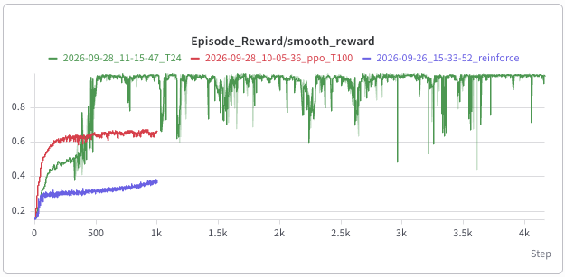
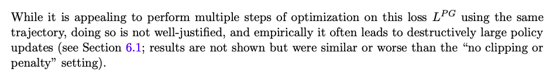
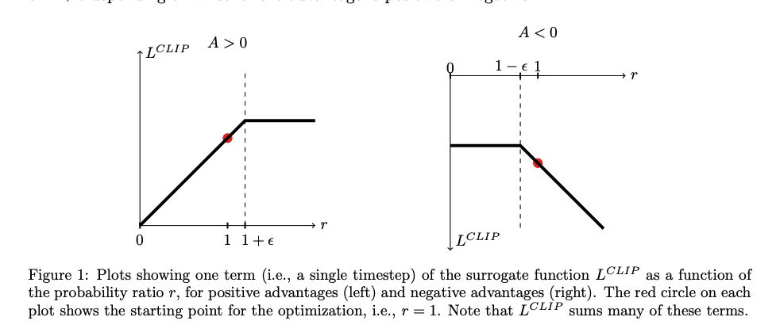
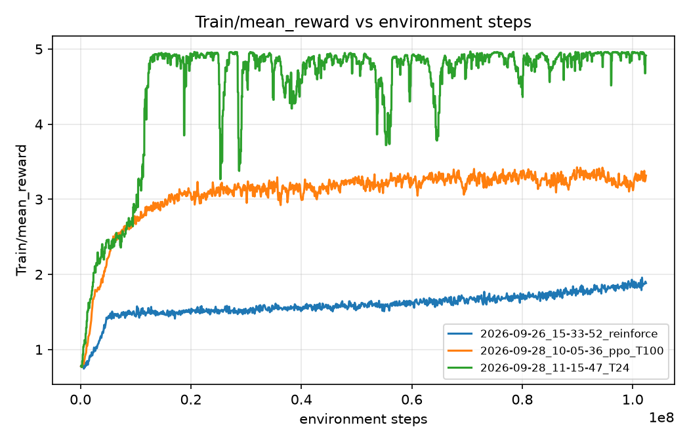
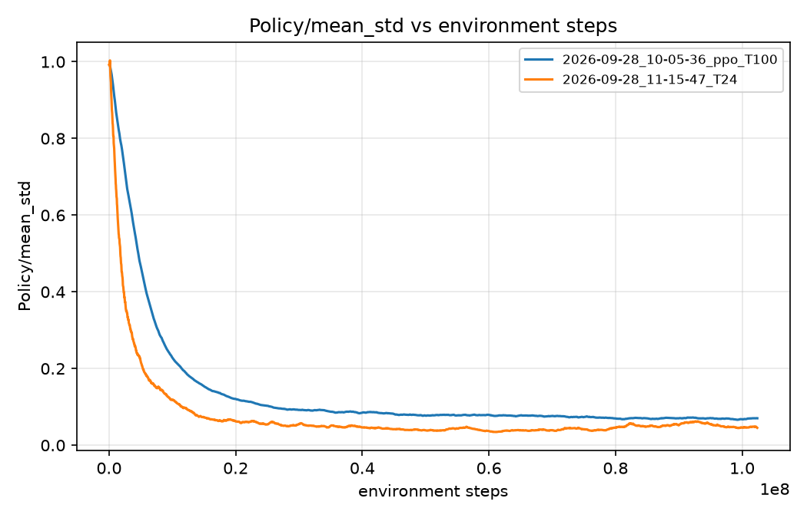

# Writeup 

This is David Zhang's (davidz10) writeup for the BOOSTER HW 1.


## Answers to questions


★ **Q1:** Williams' Theorem 1 says (r − b_ij) ∂ ln g_i / ∂ w_ij is an *unbiased*
estimate of ∂E{r | W}/∂w_ij. In your own words, what does unbiased mean here, and
why must the baseline b_ij not depend on the output y_i? (S&B's baseline b(s) in
eq. 13.10 likewise may depend on the state, but not on the action.)

An unbiased estimator $\hat{\theta}$ of a random variable $\theta$ satisfies 
$$
    E[\hat{\theta}] = \theta.
$$

In this case, if $\alpha$ is a constant learning rate, the theorem suggests that 
$$
    E[\Delta W \mid W] = \alpha \nabla_W E[r \mid W],
$$
where $\Delta W = \alpha(b_{ij} - r) \frac{\partial g_i}{\partial w_{ij}}$ 
is the increment in reward. It follows that for each element $w_{ij}$, the equality also holds after swapping order of operation between expectation and differentiation, so 
$$
   (b_{ij} - r) \frac{\partial g_i}{\partial w_{ij}}  = \frac{\partial E[r \mid W] }{\partial w_{ij}}.
$$
In other words, this justifies that the aggregate work $\Delta W$ is an identially good approximation 
for the reward accumulation, providng a formula for calculation.  


★ **Q2:** Williams' episodic update (eq. 11) multiplies *every* step's
eligibility by the *whole* episode's reinforcement. S&B's REINFORCE (eq. 13.8) and
HW2's `compute_returns` weight step t by the return *from t onward* instead. Why
is that still an unbiased estimate? (Williams' "causal" remark at the end of §5
is the idea.) Answer after the notebook, and use the variance you measured there.

Write the episodic gradient estimate as
$$
\sum_t \nabla_\theta \ln \pi(a_t \mid s_t) \sum_k r_k .
$$
Split the reward sum into rewards from before step $t$ ($k < t$) and rewards
from $t$ onward ($k \ge t$). Any reward $r_k$ with $k < t$ is already fixed by
the time $a_t$ is sampled, so it cannot depend on $a_t$. 
$$
E\big[r_k \nabla_\theta \ln \pi(a_t \mid s_t)\big] = 0,
$$

this holdes because 

$$
E_{a \sim \pi}[\nabla_\theta \ln \pi(a \mid s)] \\
= \sum_a \pi(a \mid s) \frac{\nabla_\theta \pi(a \mid s)}{\pi(a \mid s)}\\
= \nabla_\theta \sum_a \pi(a \mid s) = \nabla_\theta 1 = 0.
$$
Past rewards act like a baseline because they are independent from the current action. 
Hence, the gradients from these past rewards do not matter. 

The notebook confirms this.

| Weighting | Total gradient variance |
|---|---|
| Total return (eq. 11) | $3.061 \times 10^{-2}$ |
| Return-to-go | $4.310 \times 10^{-3}$ |
| Return-to-go − baseline | $4.651 \times 10^{-4}$ |


★ **Q3:** `GaussianActor` learns `log_std`, not σ. Connect that choice to
Williams' footnote 2 of §6 and to S&B's eq. 13.20. What is ∂ ln π / ∂ (ln σ)?


1. In this context $\sigma = \exp{\log{\texttt{std}}}$. Williams remarks that it is possible to get a negative $\sigma$ with gradient steps, which would be bad.  In Sutton and Barto, they defined $\mu = \theta_{\mu}^T s$ (MLP) and $\sigma = \exp({\theta_{\sigma}^T s_{\sigma}})$ which is guaranteed to be positive. In our implementation setting $\sigma$ to be the exp of a log ensures that $\sigma$ has the same magnitude of the std. 


2. This is the computation:

$$\pi_\theta(a \mid s) = \mathcal{N}\big(a;\ \mu_\theta(s),\ \sigma^2\big)$$

then 

$$
\pi = \frac{1}{\sigma\sqrt{2\pi}} \exp\left(-\frac{(a - \mu)^2}{2\sigma^2}\right)
\rightarrow \\
\ln \pi = -\ln \sigma - \tfrac{1}{2}\ln(2\pi) - \frac{(a - \mu)^2}{2\sigma^2}
$$

$$
\frac{\partial \ln{\pi}}{\partial (\ln{\sigma})} = \frac{\partial \ln{\pi}}{\partial {\sigma}}  \frac{\partial \sigma}{\partial \ln \sigma}
$$

$$
\frac{\partial \ln{\pi}}{\partial {\sigma}} = -\frac{1}{\sigma} + \frac{(a - \m)^2}{\sigma^3}
$$
and $\frac{\partial \sigma}{\partial \ln \sigma} = \sigma$, so

$$
\frac{\partial \ln{\pi}}{\partial (\ln{\sigma})} = \frac{(a - \mu)^2}{\sigma^2} - 1.
$$


★ **Q4:** Section 7 of the notebook shows two different errors from trying to
backpropagate through log-probabilities produced during collection. Explain
both. Then: `update()` never uses the stored `old_log_probs` — so why does the
storage keep them?

1.The log-probabilities are computged inside
`torch.inference_mode()`, so PyTorch recorded no computation graph. There's nothing to differentiate.

2. An inference tensor cannot enter a
tracked computation at all unless it is cloned first.

update() rescores the
stored actions with `actor.evaluate_actions(obs, actions)` with the current
policy. That gives log-probabilities with a graph so we can backprop.

3. REINFORCE's `update()` does not use `old_log_probs` because it takes one
gradient step per batch.  The storage keeps them for PPO. See PPO.update(). 

```python
  p = torch.exp(log_probs - old_log_probs)
  policy_loss = -1 * (torch.min(p * advantages, torch.clip(p,1-self.clip_param,1+self.clip_param) * advantages)).mean()
```
here we make use of the ratio between the two policies. 


★ **Q5:** How many environment steps per second did this run get (from the
Slurm log)? Describe the reward curve's shape in two sentences.

From the slurm log, the steps / second were on the magnitue of 180,000. 

For the curve shape, see the picture below. 




The blue curve (REINFORCE) shoots up in the fist few episodes but quickly hits a plateau where it slowly increases without too much noise. However, the rate of change is rather slow over the scale of the 1024 training steps. Upon termination, it is still training and the rewards are climbing, but we are uncertain when it will stop. 

★ **Q6:** Trace `uv run train Course-HW2-DoubleCartpole-Balance-PPO` from the
shell to your `PPO.update`. Name each file and function the call passes
through.

1. `uv run train` runs `.venv/bin/train`, which calls `mjlab.scripts.train.main()`, 
presumably from the file `mjlab/scripts/train.py`.
  
2. `main()` imports `mjlab.tasks`, which sets the course tasks 
directory to `src/course_tasks`, which then checks 
the `__init__.py`, which imports 
`hw2/__init__.py`. 

`hw2/__init__.py` performs a `register_mjlab_task(...)` which takes in 
`rl_cfg=ppo_...,`.

Here is a sample PPO config declaration in `__init__.py`

```python
def ppo_double_cfg_t24() -> PpoRunnerCfg: 
  cfg = ppo_double_cfg()
  cfg.num_steps_per_env = T24_STEPS
  cfg.experiment_name = "hw2_ppo"
  cfg.run_name = "T24"
  cfg.max_iterations = T24_ITERATIONS
  return cfg 
```

3. We can check the `PpoRunnerCfg` class, which is imported via
```python
from course_tasks.hw2.runner import PpoRunnerCfg, ReinforceRunner, ReinforceRunnerCfg
```
in `hw2/runner.py`, there is a definition of the runner config as 
```python 
@dataclass
class PpoRunnerCfg(ReinforceRunnerCfg):
  """Runner config for the PPO tasks."""

  algorithm: PpoAlgorithmCfg = field(default_factory=PpoAlgorithmCfg)  # pyright: ignore[reportIncompatibleVariableOverride]
```
which inherits from `ReinforceRunnerCfg`. 

4.`ReinforceRunnerCfg` is long but it has a 
`class_name` conifg, which extends from `self.alg_cfg`, which is passed in as `train_cfg`, 
where the entries are either `REINFORCE` or `PPO`. This is matched via the dict 
`_ALGORITHMS` to the `PPO` class from `hw2/ppo.py`. 

5. Finally, `PPO.update()` is defined in the PPO class.


★ **Q7:** What does §2.1 say goes wrong if you take many optimization steps on
L^PG with the same batch? Which case in Figure 1 does the `min` in eq. 7 guard
against, and why is it a *pessimistic* bound?


$$L^{PG}(\theta) = \hat{\mathbb{E}}t\left[\log \pi\theta(a_t \mid s_t), \hat{A}_t\right]$$

The paper says that taking multiple optimization steps on L^PG with the same
trajectories lacks justification, and 
empirically often leads to
"destructively large policy updates". 



The data came from $\pi_{old}$, but nothing in
L^PG stops the new policy from moving far away from $\pi_{old}$. After a few steps
the gradient estimate no longer describes the current policy, and the policy
can collapse.



In Figure 1, the `min` ensures that the ratio does not exceed the clipped range, i.e. $r > 1 + \epsilon$ when $A > 0$ 
 or $r < 1 − \epsilon$ when $A < 0$. When the clipped term becomes the smaller term, the objective goes flat and its gradient is zero. The update is not incentivized to push the ratio further.

Clipping is "pessimistic" because L^CLIP = min(unclipped, clipped) is bounded above by the 
unclipped surrogate L^CPI. Conversely, L^CLIP is a lower bound on the unclipped loss. 

The paper remarks that "With this
scheme, we only ignore the change in probability ratio when it would make the objective improve,
and we include it when it makes the objective worse." This sounds a bit confusing, but we really want the objective to be minimized (worsen), so the clipping mechanism ensures that this only occurs in a selective interval. 


★ **Q9:** At equal environment steps, how do REINFORCE and PPO at T = 100
compare? They saw identical data per iteration, so what explains the difference
you observe?


RAt 1000 steps, PPO at T = 100 has rewards around 0.65 while REINFORCE has reward around 0.37. 

EINFORCE has a much smaller reward value than PPO 
PPO makes much better use of the trianing signal, while reinforce 
can be a bit noisy. This is because PPO reuses rewards from each batch 
for several epochs, and the GAE reduces variance for each learning run. 
REINFORCE takes a high variance gradient step each batch.

This shows how given the same data, a better algorithm 
leads to superior performance.


★ **Q10:** What did shortening the rollout to 24 steps change? Describe what you
*measured*, not what you expected. Then consider: the environment has a fixed
100-step horizon, but the observation contains no information about how many
steps remain. What does bootstrapping from V(s_T) at a mid-episode cut need to
know that the critic cannot see, and did that show up in your results?

Both PPO runs used the same total number of environment steps. T = 24 ran
100 × 1000 / 24 = 4166 iterations. 
With T = 24, smoothed reward climbed past 0.9 within about 500
iterations and stayed near 1.0 for the rest of training. T = 100 leveled off
around 0.65. 

Compared with T100, T24 had 4× more policy updates on the same
amount of training data.
Each advantage estimate relies on the critic instead of Monte Carlo sampling. The T = 24 curve was also much less stable,
with frequent spikish drops; but they soon rebounded. 
T=100 on the other hand was smooth sailing. 

At a mid-episode cut, bootstrapping from V(s_T) stands in for the return from
the rest of the episode. That return depends on how many steps are left before
the fixed 100-step horizon. Because 100 is not a multiple of 24, cuts land at
many different points in the episode (step 96 has 4 steps left, step 20 has
80). 

The observation holds no time information, so the critic cannot tell
these cases apart. It can only learn a value averaged over time remaining,
which overestimates near the end of an episode and underestimates near the
start. 
It may explain some of the instability, though, because advantages near the cuts get a biased baseline. 

With more time, I could consider adding the time data to the critic and let it predict accordingly, to see if the instability problem relaxes. 


## Ad Hoc


### The Step 8 comparison plot, x-axis `Train/total_env_steps`, all three runs.



Here is the plot for the three runs. 


### `Policy/mean_std` for your two PPO runs.


Here is the plot for the two PPO runtwo PPO runs.


### One paragraph on what broke while you built PPO and how you found it.

1. Wrong probability ratio, I defined the ratio to be 
`log_probs / old_log_probs`, which is not correct. 
I saw that the formula was incorrect while reading update code and chagned it to  `torch.exp(log_probs - _old_log_probs).`
2. logs only showed the last minibatch. We ran the CPU smoke test on PPO T100. To record this, we added running totals with .item() and averaged over steps. 
3. Inference tensors cannot be found for backward. The CPU smoke test crashed.
I read through the jupyter notebook and saw the same issue. The solution is to wrap the critic call in `with torch.no_grad(): ...`.


### The task ids, run directories and checkpoint filenames you want graded.

PPO runs: T24 / T100

course/logs/rsl_rl/hw2_ppo/2026-09-28_11-15-47_T24/model_4165.pt
course/logs/rsl_rl/hw2_ppo/2026-09-28_10-05-36_ppo_T100/model_999.pt

course/logs/rsl_rl/hw2_ppo/2026-09-28_11-15-47_T24
course/logs/rsl_rl/hw2_ppo/2026-09-28_10-05-36_ppo_T100

Reinforce

course/logs/rsl_rl/hw2_reinforce/2026-09-26_15-33-52_reinforce/model_999.pt
course/logs/rsl_rl/hw2_reinforce/2026-09-26_15-33-52_reinforce/


Names included
REINFORCE_RUN = 2026-09-26_15-33-52_reinforce/
T100_RUN = 2026-09-28_10-05-36_ppo_T100
T24_RUN = 2026-09-28_11-15-47_T24

T24_LOG = slurm-3201679.out
T100_LOG = slurm-3201529.out
REINFORCE_LOG = slurm-3201557.out
